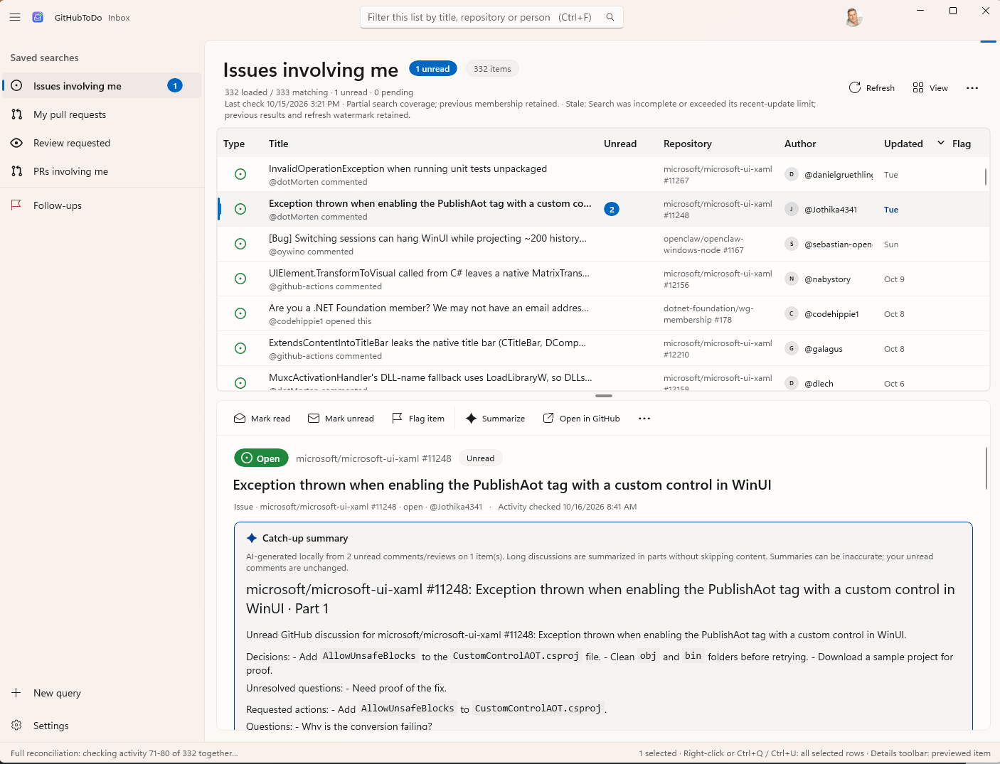
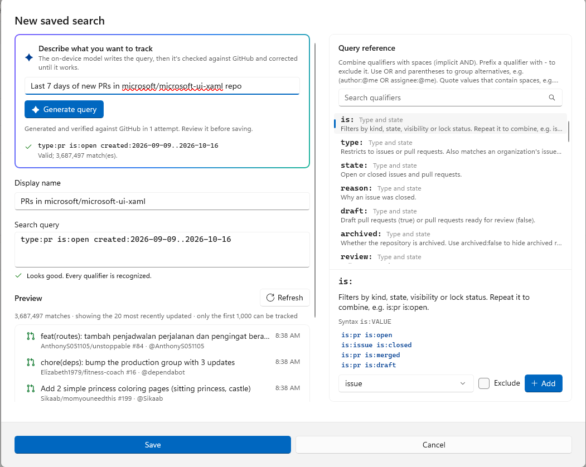

# GitHubToDo

### Your GitHub work, without the tab overload.

An inbox for the issues, pull requests, and reviews that need your attention. GitHubToDo brings your GitHub searches into a native Windows app, remembers what you've read, and helps you pick up where you left off.

**[Download for Windows](https://github.com/dotMorten/GitHubToDo/releases/latest)** · [Report a bug or suggest a feature](https://github.com/dotMorten/GitHubToDo/issues)



## Less checking. More catching up.

Following a project shouldn't mean reopening the same tabs to figure out what's changed.

GitHubToDo gives you a familiar, email-style workspace: saved searches on the left, issues and pull requests above, and the conversation below. See what's new, read the discussion, and move on.

- **Read it once.** An issue can appear in several searches, but its read state is shared across all of them. Catch up in one view and the others catch up too.
- **Go straight to what's new.** Discussions open at the first unread comment. Read as you scroll, or explicitly mark items read or unread, individually or in bulk.
- **Keep your own replies from becoming work.** When your activity is the latest, the item is treated as read. You can still mark it unread when you want to revisit it.
- **Turn down the bot noise.** Ignore activity from selected accounts so automated comments don't keep pulling you back in.
- **Remember the things that matter.** Flag an entire issue or a particular comment. Your Follow-ups view keeps it handy, even if it stops matching a saved search.
- **Make the workspace yours.** Resize and sort columns, choose a comfortable row density, filter the current list, and switch between light, dark, or your system theme.

## Your searches. Your inbox.

Start with items involving you, your pull requests, and reviews requested from you. Then add whatever you need using GitHub's search syntax.

| What you want to follow | Example search |
| --- | --- |
| Open issues and pull requests involving you | `state:open archived:false involves:@me` |
| Your open pull requests | `is:pr author:@me state:open` |
| Pull requests awaiting your review | `is:pr review-requested:@me state:open archived:false` |
| Bugs in a particular repository | `repo:dotnet/runtime is:issue is:open label:bug` |

The query builder includes a searchable qualifier reference and a live results preview, so you can see what you're about to track before saving it.

### Describe it instead of writing it

With a supported on-device Windows AI model, describe what you want to follow in plain language and let GitHubToDo draft the search. It checks the generated query against GitHub and can retry when validation fails. You can inspect the query, edit it, and preview the results before saving.



AI can get the intent wrong even when a query is valid. Always review the generated qualifiers and results.

## Long thread? Get the catch-up version.

Open an issue or pull request and choose **Summarize unread** to catch up on its unread comments and reviews, or **Summarize** for its original description and entire loaded discussion, including read comments (ignored accounts are excluded). Both summarize the previewed item, not other selected rows. Generated text streams into a right-hand pane alongside the discussion; on narrow windows the pane overlays it. Close the pane with **×** to cancel generation and hide it. Long discussions are summarized in parts without silently skipping content; failed or cancelled drafts are cleared.

**AI processing stays on your device.** There's no cloud AI service or AI subscription to configure. Summarizing doesn't mark anything read, and the original conversation stays available so you can check the details.

An unread summary keeps its captured excerpt when you mark the item read, even if generation is still running. New discussion activity or changes to the captured comments invalidate it; closing the pane or opening another item clears it.

Both AI features are optional and require a compatible Windows device with the local Windows AI model installed and available. GitHubToDo doesn't automatically download a model or fall back to a cloud provider. You can use the inbox and write queries yourself without AI.

## Get started

1. **[Download the latest release](https://github.com/dotMorten/GitHubToDo/releases/latest).** Choose the signed `.msix` for your PC: **ARM64** for Snapdragon/Windows on Arm, or **x64** for Intel and AMD.
2. **Install and open GitHubToDo.** Official releases include the runtimes and sign-in configuration; no developer tools or OAuth app setup needed.
3. **Sign in to GitHub.** Follow the browser authorization prompt, then explore the starter searches or add your own.

Private repositories are optional. Enable private access when signing in if you need them; GitHub requires the broad `repo` permission for that access. Your organization may also require SSO authorization or app approval.

## Your reading list, not another place to manage GitHub

Read state, follow-up flags, and ignored-account preferences stay local to your device. They don't change GitHub notifications, labels, or repository content, and they don't sync between PCs. Sign-in tokens are kept in Windows Credential Locker.

When it's time to reply, review code, or make changes, **Open in GitHub** takes you to the original issue or pull request.

### A few things worth knowing

- GitHubToDo monitors **GitHub.com** while the app is open. It checks for updates every two minutes and reconciles search membership and lightweight activity metadata every 30 minutes, reloading changed discussions rather than full-scanning every thread; it isn't a background notification service.
- GitHub search can lag behind activity and exposes at most the first 1,000 results per query. Use focused searches for the most useful inbox. Incomplete results and stale data are labelled in the app.
- Unread activity covers published comments, inline review comments, and submitted reviews, not every kind of GitHub event.
- The discussion preview focuses on readable text and Markdown. For images, external links, and the full GitHub experience, open the item in your browser.

## Build and contribute

GitHubToDo is a C# / WinUI 3 app, available under the [MIT license](LICENSE). Bug reports, ideas, and pull requests are welcome.

<details>
<summary>Building from source</summary>

On Windows, install .NET 10, WinApp CLI 0.7+, and enable Developer Mode. From the repository root:

```powershell
dotnet build .\src\GitHubToDo\GitHubToDo.csproj -p:Platform=x64
winapp run .\src\GitHubToDo\GitHubToDo.csproj --arch x64 -p Platform=x64 --no-build
```

For Windows on Arm, use `Platform=ARM64` and `--arch arm64`.

Source builds need your own [GitHub OAuth app](https://github.com/settings/developers) with **Device Flow** enabled. Enter its public client ID in Settings; no client secret is needed.

Run the core tests with:

```powershell
dotnet test .\tests\GitHubToDo.Core.Tests
```

</details>
